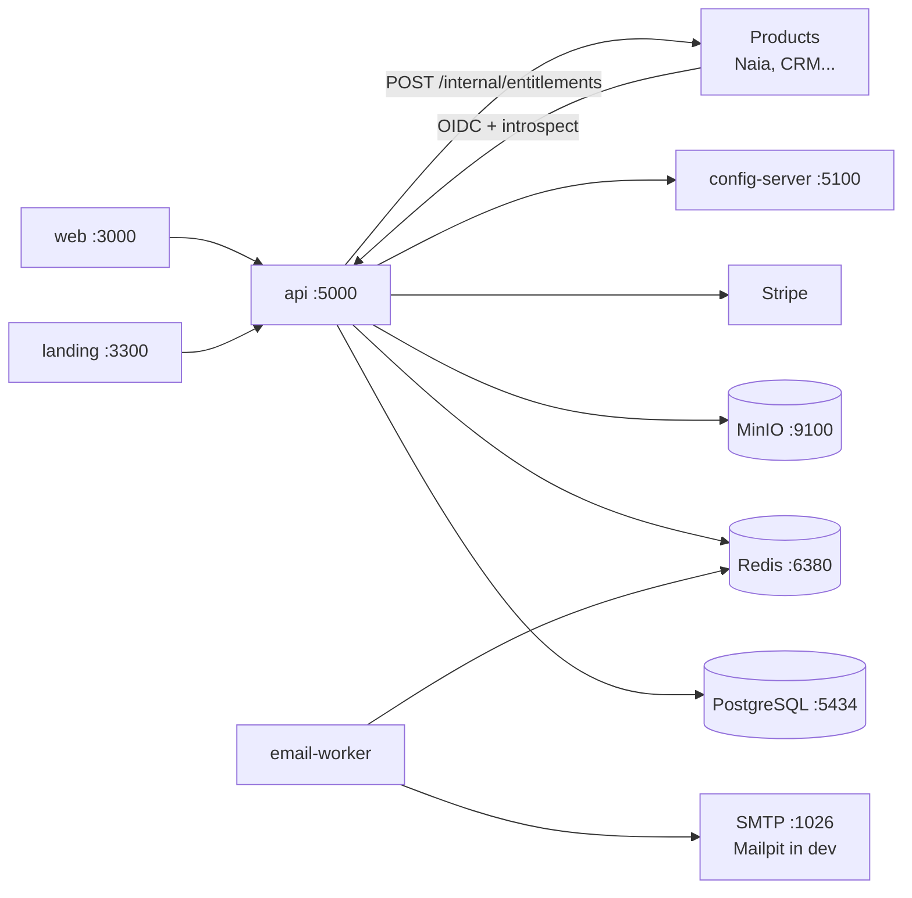

# Vianova

> **Status: open-sourced after shutdown.** Vianova ran in production at
> `vianova.software` powering account, billing, and identity for the products
> below. The services are no longer deployed — this repository is published
> as-is for reference and portfolio, and is not actively maintained.

Account, identity, and billing hub for a product ecosystem (`vianova.software`). It plays the "Atlassian ID" role: single account, 2FA, organizations, product catalog, billing portal, and an OIDC identity provider for the products (Naia and future ones). Stripe integration exists only in this repository.

## What it does

- **Identity**: registration, login, email verification, password reset,
  TOTP 2FA, and session management with global logout/revocation.
- **OIDC provider**: authorization-code flow, JWKS endpoint, token
  introspection, and short-lived scoped service tokens for product backends.
- **Organizations**: multi-workspace teams with per-product roles and
  email invites.
- **Billing**: Stripe subscriptions with per-product plans and add-on
  prices, billing portal, renewal reminders, and entitlement push to
  products over service-to-service calls.
- **Config server**: centralized per-product, per-environment configuration
  consumed by the rest of the ecosystem.

## Stack

| Layer | Choice | Why |
| --- | --- | --- |
| Runtime | Bun 1.3.x | single toolchain for apps, tests, scripts |
| Monorepo | Turborepo 2 | cached task graphs across 10 packages |
| API | Elysia | lightweight Bun-native HTTP framework |
| DB | PostgreSQL 16 + Drizzle ORM | relational source of truth, SQL migrations |
| Queue | BullMQ + Redis 7 | transactional email worker |
| Storage | MinIO/S3 | avatars and file blobs |
| OIDC/JWT | jose | JWKS, introspection, service tokens |
| Billing | Stripe | the only repo allowed to integrate Stripe |
| Frontend | TanStack Start/Router/Query | type-safe data flow via Eden Treaty client |

## Architecture



**Products never implement their own auth or billing.** They validate
Vianova-issued JWTs against the JWKS endpoint and receive entitlements via
signed service-to-service pushes. See [Public contracts](#public-contracts).

## Repository layout

| Package | Responsibility |
|---|---|
| `apps/api` | Elysia (port 5000): auth, 2FA, organizations, catalog, OIDC provider, Stripe, service tokens |
| `apps/web` | TanStack Start (port 3000): login, registration, 2FA, profile, organizations, billing portal, product switcher |
| `apps/landing` | Public landing site (port 3300) |
| `apps/email-worker` | BullMQ worker that sends transactional email |
| `apps/config-server` | Centralized per-product, per-environment configuration server (port 5100) |
| `packages/db` | Drizzle + Postgres (`vianova` database), migrations, seed |
| `packages/oidc` | JWT signing/verification (`jose`), JWKS, introspection, service tokens |
| `packages/client` | Eden Treaty client for `apps/api` |
| `packages/config-client` | Typed client for the config server |
| `packages/config` | tsconfigs + brand Tailwind theme (`via-500 #C466FF`) |

## Prerequisites

- Bun 1.3.14 (`packageManager` field is pinned)
- Docker + docker compose (Postgres 16, Redis 7, MinIO, Mailpit)

## Running in dev

```bash
docker compose up -d      # postgres :5434, redis :6380, minio :9100/:9101,
                          # mailpit :1026 (smtp) / :8026 (ui)
cp .env.example .env      # fill in secrets; see comments inside
bun install
bun run db:migrate
bun run db:seed
bun run dev
```

Dev email is captured by Mailpit at `http://localhost:8026` — nothing leaves
the machine.

Test OIDC client that simulates a product exchanging an authorization code for a JWT:

```bash
bun scripts/mock-oidc-client.ts
```

## Tests

```bash
bun test              # unit tests
bun run typecheck     # tsc --noEmit across all packages (turbo)
bun run build         # production builds (turbo)
bun audit             # dependency audit (also runs in CI)
cd packages/db && bun run db:generate   # schema → migration SQL
```

## Public contracts

Breaking these requires coordination with the products that consume them:

- `GET /oidc/authorize`, `POST /oidc/token`, `POST /oidc/introspect`, `GET /.well-known/jwks.json`
- `POST /internal/service-token`: issues a scoped service token (Vianova to product)
- Vianova calls products back at `POST {product.api_url}/internal/entitlements` with a `service:entitlements:write` token

## Security notes

- Service tokens are short-lived JWTs scoped to a single product audience and explicit scopes.
- OIDC user JWTs carry `sid` and are tied to the Vianova session, so logout and introspection can revoke access everywhere.
- File and avatar blobs live in MinIO; credentials stay server-side.
- Product-facing error responses never leak internal details; see `apps/api/src/plugins/error-sanitizer.ts`.
- CI runs `bun audit` and a full-history gitleaks scan; `.env*` files are gitignored and `.env.example` holds placeholders only.

## License and contribution

Licensed under the [MIT License](LICENSE). Contributions: see
[CONTRIBUTING.md](CONTRIBUTING.md). Note the repository is published as-is
after shutdown — issues and PRs are not actively monitored.
